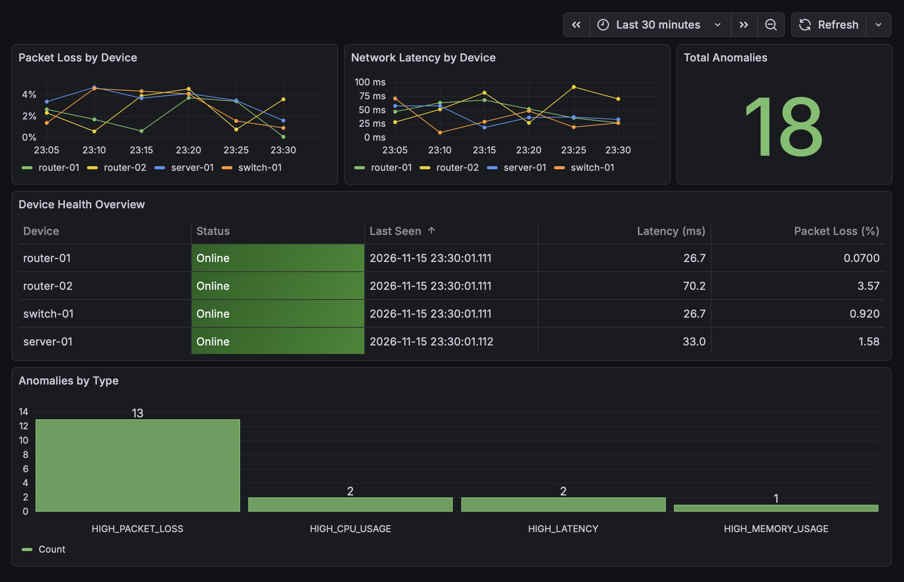
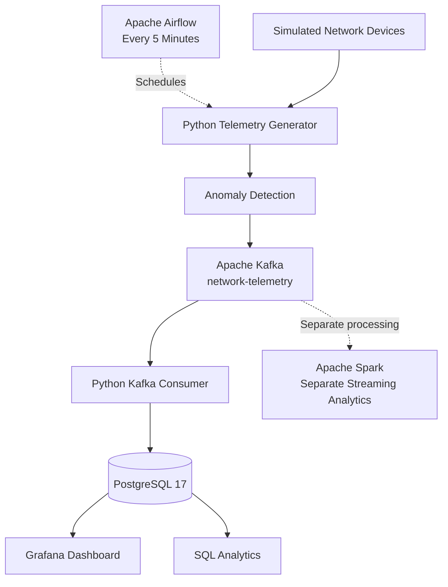

# NetPulse — Network Telemetry & Monitoring Pipeline

An end-to-end network telemetry and data engineering project built with Python, Apache Kafka, Apache Airflow, PostgreSQL, Apache Spark, Docker, and Grafana.

NetPulse simulates network device activity, detects performance anomalies, streams telemetry through Kafka, stores measurements in PostgreSQL, and visualizes network health through an interactive Grafana dashboard.

The project demonstrates practical experience with networking, event-driven architecture, data engineering, workflow orchestration, database analytics, and containerized applications.

> **Note:** NetPulse currently uses simulated network telemetry rather than collecting live measurements from physical network equipment.

## Dashboard Preview



The Grafana dashboard provides visibility into network latency, packet loss, device health, and detected anomalies.

## System Architecture



### How the Pipeline Works

1. **Apache Airflow** schedules telemetry generation every five minutes.
2. **Python** generates synthetic network metrics for four simulated devices.
3. **Anomaly detection** evaluates the generated telemetry for abnormal conditions.
4. **Apache Kafka** receives JSON telemetry events through the `network-telemetry` topic.
5. **Python Kafka Consumer** processes the events and ingests them into PostgreSQL.
6. **PostgreSQL** stores device information, telemetry measurements, and detected anomalies.
7. **Grafana** queries PostgreSQL to visualize network performance and device health.

Apache Spark is included as a separate streaming analytics component. It is not part of the scheduled Airflow-to-PostgreSQL ingestion pipeline.

## Technology Stack

| Technology | Purpose |
|------------|---------|
| Python 3.12 | Telemetry generation, anomaly detection, and ingestion |
| Apache Kafka 4.1.1 | Event streaming and message transport |
| Apache Airflow | Workflow scheduling and automation |
| PostgreSQL 17 | Telemetry and anomaly storage |
| Apache Spark 3.5.7 | Separate streaming analytics |
| Grafana 12.3.1 | Network monitoring dashboards |
| Docker Compose | Containerized infrastructure |
| SQL | Database management and analytics |
| Git & GitHub | Version control |

## Features

### Network Telemetry Simulation

NetPulse simulates four network devices:

| Device | Type | Simulated IP Address |
|--------|------|----------------------|
| router-01 | Router | 192.168.1.1 |
| router-02 | Router | 192.168.1.2 |
| switch-01 | Switch | 192.168.1.10 |
| server-01 | Server | 192.168.1.100 |

Generated telemetry includes:

- Device identifier
- Timestamp
- Network latency (ms)
- Packet loss (%)
- Bandwidth (Mbps)
- CPU utilization (%)
- Memory utilization (%)
- Device status

The generator simulates normal network activity and abnormal conditions, including elevated latency, packet loss, and offline devices.

### Anomaly Detection

NetPulse evaluates telemetry measurements and detects network health anomalies.

| Anomaly | Description |
|---------|-------------|
| `HIGH_LATENCY` | Elevated network latency |
| `HIGH_PACKET_LOSS` | Excessive packet loss |
| `HIGH_CPU_USAGE` | High CPU utilization |
| `HIGH_MEMORY_USAGE` | High memory utilization |
| `DEVICE_OFFLINE` | Device reported as offline |

Detected anomalies are linked to telemetry records in PostgreSQL.

### Apache Kafka Event Streaming

Apache Kafka provides asynchronous communication between the telemetry producer and consumer.

**Kafka topic:** `network-telemetry`

The Python producer serializes telemetry events as JSON and publishes them to Kafka.

A containerized Python consumer processes the messages for PostgreSQL ingestion.

### Apache Airflow Automation

Apache Airflow automatically schedules telemetry generation.

**DAG:** `netpulse_telemetry_producer`

**Schedule:** Every five minutes

```cron
*/5 * * * *
```

Each execution:

1. Initializes the Kafka producer.
2. Generates telemetry for four simulated devices.
3. Runs anomaly detection.
4. Publishes four telemetry events to Kafka.
5. Confirms successful Kafka message delivery.

The DAG uses `catchup=False` and limits concurrent active runs to one.

The repository also includes a separate database health-check DAG.

### PostgreSQL Database

NetPulse uses PostgreSQL to store network telemetry and anomaly information.

The database contains three primary tables:

| Table | Description |
|-------|-------------|
| `devices` | Registered simulated network devices |
| `telemetry` | Network performance measurements and device status |
| `anomalies` | Detected anomalies linked to telemetry records |

Foreign key constraints maintain relationships between devices, telemetry, and anomalies.

SQL analytics queries are available in:

`sql/network_analytics.sql`

### Apache Spark Streaming

NetPulse includes a PySpark streaming component for additional event processing and analytics.

Source file:

`src/processing/spark_streaming.py`

Spark is maintained separately from the main scheduled ingestion pipeline.

### Grafana Monitoring Dashboard

The **NetPulse — Network Monitoring** dashboard contains five panels.

| Panel | Visualization | Purpose |
|-------|---------------|---------|
| Network Latency by Device | Time series | Compare latency across devices |
| Packet Loss by Device | Time series | Monitor packet loss |
| Device Health Overview | Table | Display latest device status and metrics |
| Anomalies by Type | Bar chart | Compare anomaly categories |
| Total Anomalies | Stat | Display anomaly count for the selected time range |

The dashboard supports configurable time ranges and data refresh.

The exported dashboard JSON is available at:

`grafana/dashboards/netpulse-network-monitoring.json`

## Project Structure

```text
NetPulse/
├── airflow/
│   ├── dags/
│   │   ├── netpulse_health_check.py
│   │   └── netpulse_telemetry_producer.py
│   └── .env.example
│
├── docker/
│   ├── compose.yml
│   ├── Dockerfile.airflow
│   └── Dockerfile.consumer
│
├── docs/
│   └── screenshots/
│       └── netpulse-dashboard.png
│
├── grafana/
│   └── dashboards/
│       └── netpulse-network-monitoring.json
│
├── sql/
│   ├── schema.sql
│   ├── seed_devices.sql
│   └── network_analytics.sql
│
├── src/
│   ├── consumer/
│   │   └── kafka_consumer.py
│   ├── database/
│   │   ├── connection.py
│   │   └── ingest.py
│   ├── processing/
│   │   ├── anomaly_detector.py
│   │   └── spark_streaming.py
│   └── producer/
│       ├── kafka_producer.py
│       └── telemetry_generator.py
│
├── tests/
│   ├── test_anomaly_detector.py
│   ├── test_database.py
│   └── test_telemetry.py
│
├── requirements.txt
├── .gitignore
└── README.md
```

## Getting Started

### Prerequisites

Install the following tools:

- Git
- Docker Desktop with Docker Compose
- Python 3.12
- Java runtime for local Apache Spark execution

Ensure Docker Desktop is running before starting the services.

### 1. Clone the Repository

```bash
git clone https://github.com/GabrielBGN/NetPulse.git
cd NetPulse
```

### 2. Set Up Python

Create a virtual environment:

```bash
python3.12 -m venv .venv
```

Activate it on macOS or Linux:

```bash
source .venv/bin/activate
```

Install the dependencies:

```bash
python -m pip install -r requirements.txt
```

Dockerized services use their own container environments. The local Python environment is useful for running scripts and tests.

### 3. Configure Environment Variables

Copy the example configuration:

```bash
cp airflow/.env.example airflow/.env
```

Open `airflow/.env` and replace the placeholder passwords.

Example configuration:

```dotenv
# PostgreSQL initialization
POSTGRES_PASSWORD=replace_with_postgres_password

# Application database connection
DB_HOST=postgres
DB_PORT=5432
DB_NAME=netpulse
DB_USER=netpulse
DB_PASSWORD=replace_with_postgres_password

# Grafana administrator
GRAFANA_ADMIN_PASSWORD=replace_with_grafana_password
```

**Important:** `POSTGRES_PASSWORD` and `DB_PASSWORD` must contain the same password.

The configuration above targets PostgreSQL inside Docker.

For Python scripts running directly on the host machine, use:

```dotenv
DB_HOST=127.0.0.1
DB_PORT=5433
```

Never commit `airflow/.env` or real credentials to GitHub.

### 4. Start Docker Services

Run from the project root:

```bash
docker compose --env-file airflow/.env -f docker/compose.yml up -d --build
```

This starts:

- Apache Kafka
- PostgreSQL
- Apache Airflow
- Python Kafka Consumer
- Grafana

Check container status:

```bash
docker compose --env-file airflow/.env -f docker/compose.yml ps
```

### 5. Automatic Database Initialization

When PostgreSQL starts with an empty data volume, NetPulse automatically initializes its database.

Two scripts run in order:

**1. `sql/schema.sql`**

Creates the following tables:

- `devices`
- `telemetry`
- `anomalies`

It also creates the required primary keys, foreign keys, sequences, and constraints.

**2. `sql/seed_devices.sql`**

Registers the four simulated network devices.

Both scripts are mounted into PostgreSQL's initialization directory:

```text
/docker-entrypoint-initdb.d/
```

They execute in this order:

```text
01-schema.sql
02-seed-devices.sql
```

**Important:** Initialization scripts execute only when the PostgreSQL data directory is empty. Existing database volumes are preserved during normal restarts.

The schema and seed scripts have been successfully tested using a fresh PostgreSQL 17 container.

Verify registered devices:

```bash
docker compose --env-file airflow/.env -f docker/compose.yml \
  exec -T postgres psql -U netpulse -d netpulse \
  -c "SELECT device_id, device_type, ip_address FROM devices ORDER BY device_id;"
```

Expected result: four registered devices.

### 6. Access Apache Airflow

Open:

http://localhost:8080

Sign in using the credentials provided by the Airflow installation.

Find the DAG:

`netpulse_telemetry_producer`

Enable it if paused.

Once enabled, Airflow generates and publishes telemetry every five minutes.

### 7. Verify Kafka Consumer Activity

View consumer logs:

```bash
docker compose --env-file airflow/.env -f docker/compose.yml \
  logs --tail=50 consumer
```

The consumer should process telemetry events published by the Airflow DAG.

### 8. Verify PostgreSQL Telemetry

Count stored telemetry records:

```bash
docker compose --env-file airflow/.env -f docker/compose.yml \
  exec -T postgres psql -U netpulse -d netpulse \
  -c "SELECT COUNT(*) AS total_telemetry FROM telemetry;"
```

Count detected anomalies:

```bash
docker compose --env-file airflow/.env -f docker/compose.yml \
  exec -T postgres psql -U netpulse -d netpulse \
  -c "SELECT COUNT(*) AS total_anomalies FROM anomalies;"
```

After the pipeline has processed events, the telemetry table should contain records.

### 9. Configure Grafana

Open:

http://localhost:3000

Sign in using:

```text
Username: admin
Password: Value of GRAFANA_ADMIN_PASSWORD
```

Create a PostgreSQL data source with:

```text
Host: postgres:5432
Database: netpulse
Username: netpulse
Password: Value of POSTGRES_PASSWORD
```

Disable TLS for this local Docker-based connection.

Save and test the data source.

Import the dashboard JSON:

`grafana/dashboards/netpulse-network-monitoring.json`

Select the PostgreSQL data source during import if prompted.

Once telemetry has been ingested, the dashboard should display network performance and anomaly information.

Grafana datasource configuration and dashboard import are currently manual setup steps.

### 10. Stop the Services

Stop the NetPulse containers:

```bash
docker compose --env-file airflow/.env -f docker/compose.yml down
```

Docker named volumes preserve PostgreSQL, Kafka, and Grafana data between normal restarts.

Avoid running `down -v` unless you intentionally want to remove the associated stored data.

## Local Service Addresses

| Service | Address |
|---------|---------|
| Apache Airflow | http://localhost:8080 |
| Grafana | http://localhost:3000 |
| Apache Kafka | 127.0.0.1:9092 |
| PostgreSQL | 127.0.0.1:5433 |

Containers communicate internally through Docker service names such as `kafka` and `postgres`.

## Testing

NetPulse includes automated tests for:

- Telemetry generation
- Anomaly detection
- Database functionality

Run the test suite from the project root:

```bash
python -m unittest discover -s tests -v
```

Database-dependent tests may require PostgreSQL to be running and the appropriate environment variables to be configured.

Validate Docker Compose:

```bash
docker compose --env-file airflow/.env -f docker/compose.yml config --quiet
```

## Future Improvements

Potential enhancements include:

- Real network monitoring using SNMP or ICMP
- Automated Grafana dashboard and datasource provisioning
- Email and webhook anomaly alerts
- Expanded Apache Spark analytics
- GitHub Actions CI/CD testing
- Additional network performance metrics
- Historical trend analysis
- Larger simulated network environments

## Learning Objectives

NetPulse demonstrates practical experience with:

- Network monitoring concepts
- Python application development
- Event-driven data pipelines
- Apache Kafka messaging
- Apache Airflow workflow orchestration
- PostgreSQL database design
- SQL analytics
- Apache Spark streaming
- Docker containerization
- Grafana visualization
- Git and GitHub version control

## Repository

[NetPulse on GitHub](https://github.com/GabrielBGN/NetPulse)
